# 🎯 Darts Club Portal

**One web app for the whole darts club:** an Elo ranking for every match you
play and a transparent penalty cash box for league matchdays. One login, one
design, German and English, light and dark, made for the phone at the board.

[](https://github.com/reserve85/DartsClubPortal/actions/workflows/test.yml)
[](https://github.com/reserve85/DartsClubPortal/pkgs/container/darts_club_portal)
[](LICENSE)

## Goal

Club life produces two kinds of numbers: *who plays how well* and *who owes
the cash box how much*. Spreadsheets and chat groups lose both. The portal
keeps them in one place, fair and visible for every member, and takes the
work off the captain and the cashier.

## Features

**Elo ranking** (module `elo`)
- Enter a match in seconds on the phone: pick two players, tap the result -
  one button per valid score for every format (best of 1 to 21), optional
  180s, high finishes, low darts, average.
- Live ranking with podium, monthly / yearly / all-time view, rank movements.
- Player pages with Elo curve, records and statistics; head-to-head with win chance.
- Corrections recalculate the history automatically.
- Mails: each match or a daily summary, plus a **monthly report** with the
  full table, rank changes and highlights.

**Penalty cash box** (module `penalty`)
- Teams, players, seasons; matchdays with participants.
- Penalty catalog with a fee per team, group penalties ("180 → everybody
  else pays"), doubles and manual penalties.
- Payments and payouts by the team's cashier, balances and credits per
  player, one transparent financial overview for everybody.
- Mails: each penalty, a daily digest, payment receipts.

**Members - one place for every person**
- Every player with or without a login: teams of the season, Elo and account
  at a glance, filters with counts (without account, invited, without Elo ...).
- **Quick add:** type a name, press Enter - several at once, one per line.
- **Invite** or **add to Elo** straight from the list; a member page with
  teams, Elo, account (invite, link, unlink) and the picture.
- Player pictures are cropped round like in a messenger app: move and zoom
  inside the circle.

**For the whole club**
- Roles *System / Admin / User* plus the assignments *captain* and *cashier*;
  admin rights split into the areas *Elo*, *Penalty* and *Portal*. A page
  "Who may do what?" explains everything to every member.
- Invitations, self-registration with approval, members change their own
  e-mail (with a confirmation link) and password.
- **Club account** for the shared tablet at the board: the only account with
  a QR login, printed as an A4 poster with club logo and address.
- **Import & Export:** full backup (database, pictures, club logo) as one ZIP,
  restore with a safety copy taken first, CSV exports, import of the old Elo
  and penalty databases.
- Audit log, unsubscribe link in every optional mail, cookie-free and
  tracking-free design.

## Screenshots

| Elo ranking | Head-to-head |
|---|---|
| 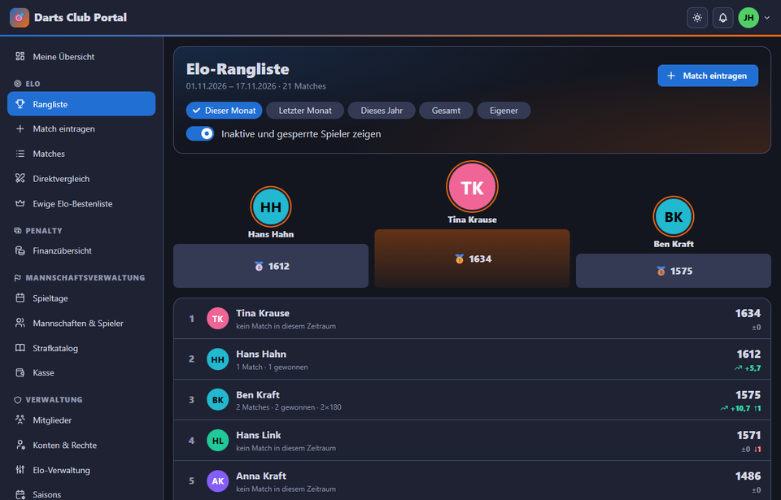 | 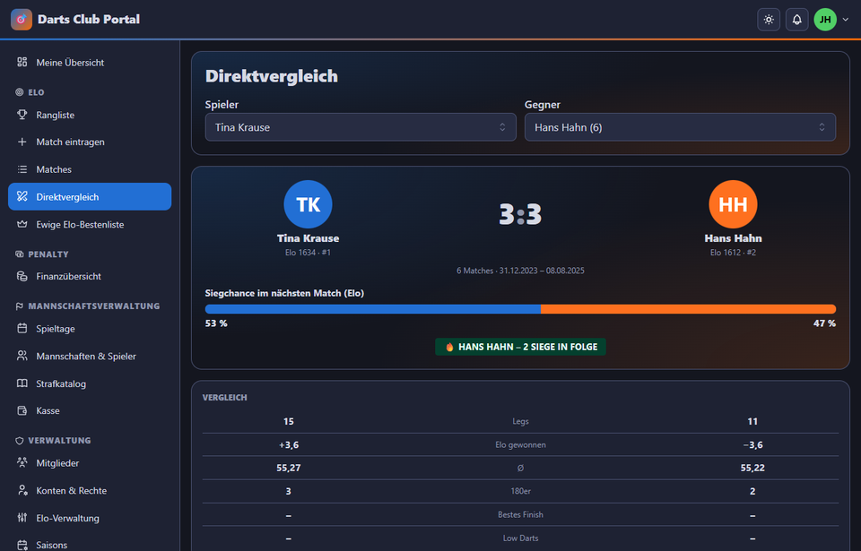 |

| Financial overview | Members |
|---|---|
| 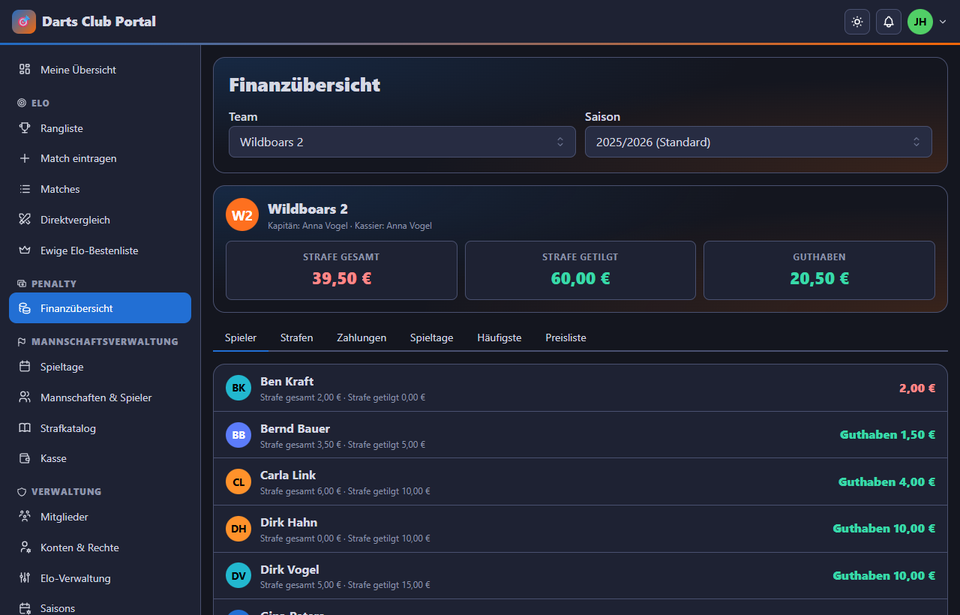 | 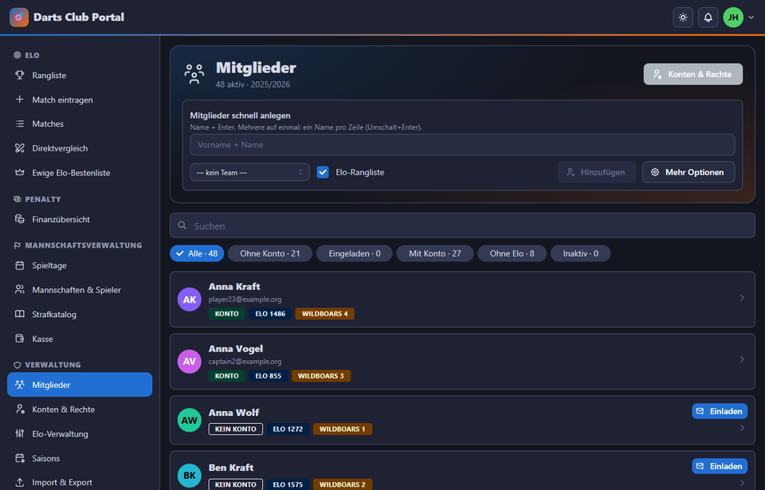 |

| Match entry | Members | Member | Import & Export |
|---|---|---|---|
| 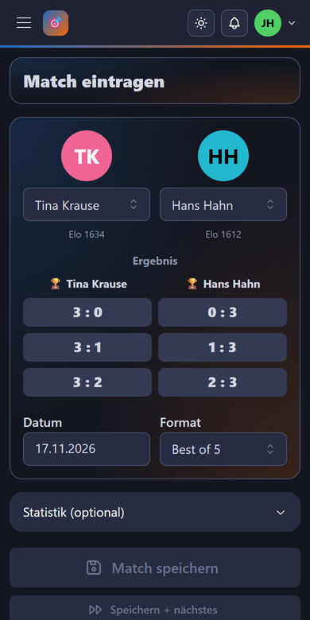 | 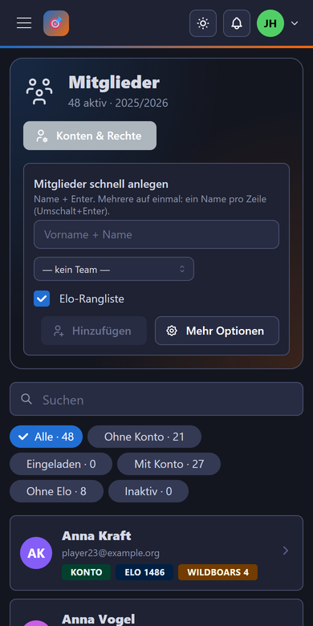 | 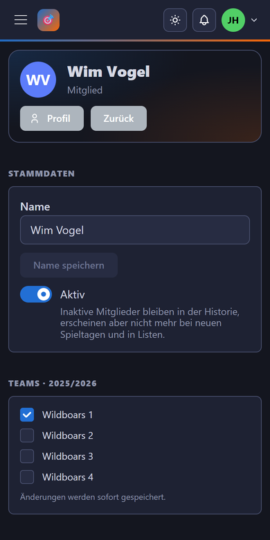 | 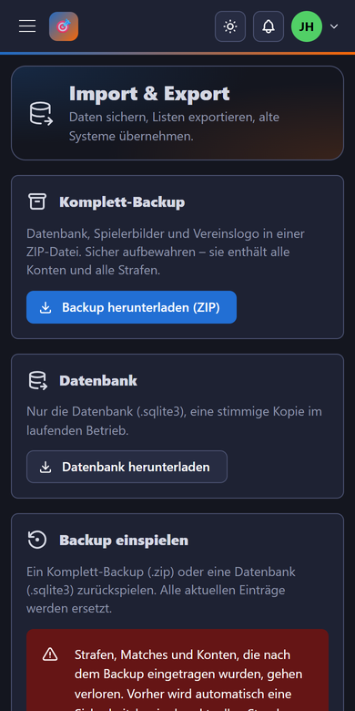 |

| Matchday | Penalty | Settings | Login |
|---|---|---|---|
| 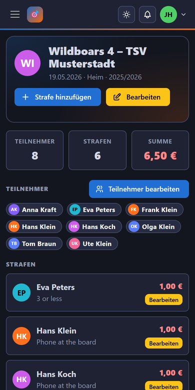 | 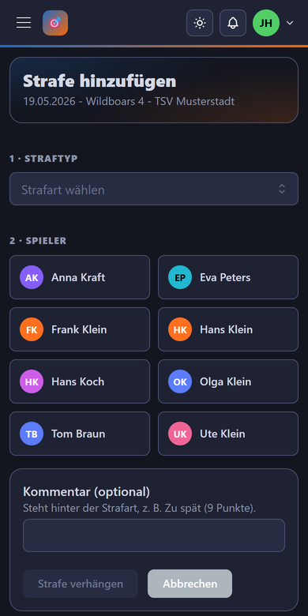 | 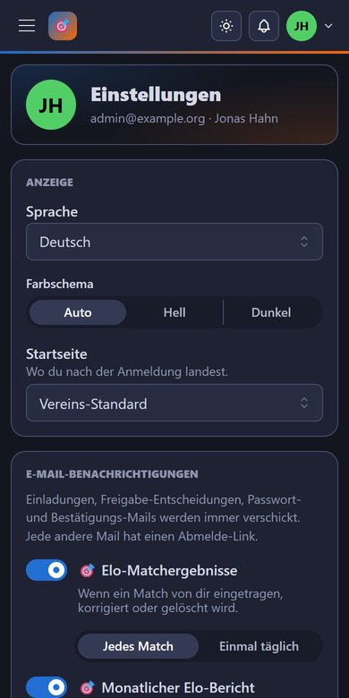 | 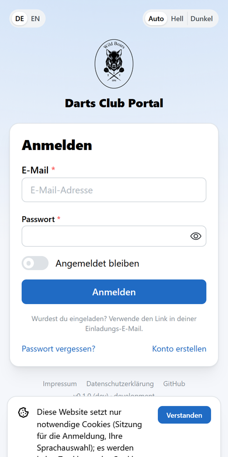 |

<sub>Demo data with invented names.</sub>

## Installation

You need a machine with Docker (a NAS like Synology / QNAP works fine).

**Portainer** (recommended for a NAS)
1. *Stacks → Add stack*, paste [`portainer_compose.yaml`](portainer_compose.yaml).
2. Replace every `CHANGE_ME`: at least `DJANGO_SECRET_KEY`,
   `DJANGO_ALLOWED_HOSTS` (your host name, no `https://`),
   `DJANGO_SUPERUSER_EMAIL` / `DJANGO_SUPERUSER_PASSWORD`.
3. Deploy, open `http://<host>:8000` and log in with the admin e-mail.

**docker compose**
```bash
git clone https://github.com/reserve85/DartsClubPortal.git && cd DartsClubPortal
cp .env.example .env        # set DJANGO_SECRET_KEY + DJANGO_SUPERUSER_* at least
docker compose up -d --build
```

Every option is documented in [`portainer_compose.yaml`](portainer_compose.yaml)
and [`.env.example`](.env.example): modules (`MODULES=elo,penalty`), SMTP for
the mails, imprint / privacy contact, HTTPS behind a reverse proxy, Elo
parameters. Data (SQLite, logo, pictures) lives in the volume `dart_data`.

**Backups:** *Administration → Import & Export* downloads a full backup
(database, pictures, club logo) as one ZIP and restores it again - a safety
copy of the current state is saved to `data/backups` first.

**Coming from the old systems?** *Administration → Import & Export → Import* takes the
penalty database (`db.sqlite3`) and the Elo database or backup ZIP – with a
preview before anything is saved. See [docs/SWITCH_OVER.md](docs/SWITCH_OVER.md).

## Security

- Passwords are hashed (Django PBKDF2), forms are CSRF-protected, logins and
  sign-ups are rate limited, sign-up has a honeypot and needs an admin's approval.
- Every change of money, penalties, users and roles lands in the audit log.
- Only essential cookies, no tracking, no third-party requests; mails carry
  one-click unsubscribe links.
- Runs as an unprivileged user in the container; set
  `DJANGO_SECURE_SSL_REDIRECT=true` (+ HSTS) when you serve it over HTTPS.
- Found a vulnerability? Please report it privately via a
  [GitHub security advisory](https://github.com/reserve85/DartsClubPortal/security/advisories/new)
  instead of a public issue.

## Development

Django 5.2 · django-allauth · React 19 + Mantine 9 via Inertia · Vite · SQLite ·
pytest (800+ tests) · ruff. Setup, architecture and all details:
[docs/DETAILS.md](docs/DETAILS.md), [docs/ARCHITECTURE.md](docs/ARCHITECTURE.md),
roles: [docs/ROLES.md](docs/ROLES.md).

## Support the project

The portal is free and stays free. If it saves your club some evenings,
a coffee for the developer is very welcome:

[](https://paypal.me/TobiasWKraft/5)

## License

[MIT](LICENSE) © Tobias Kraft
